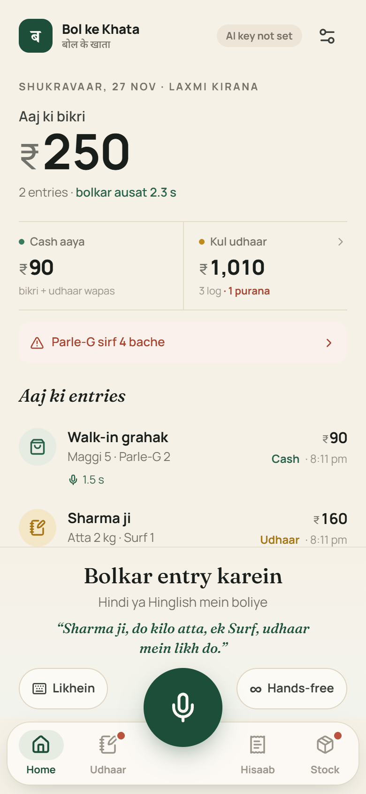
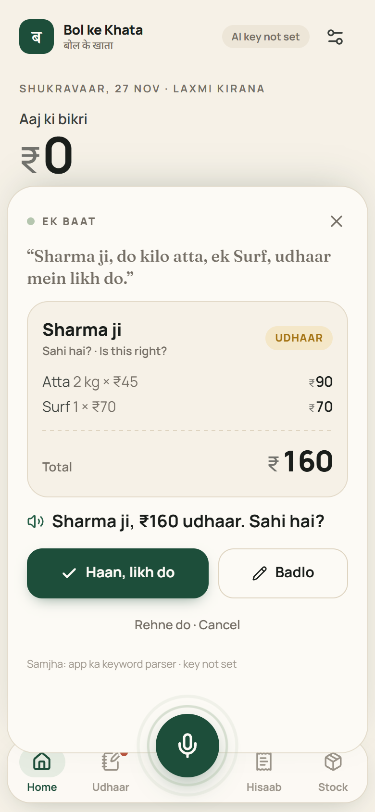
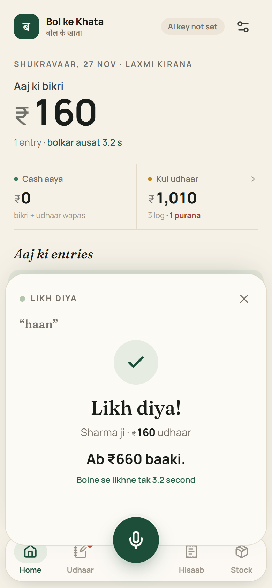
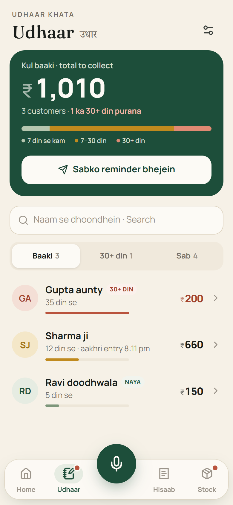
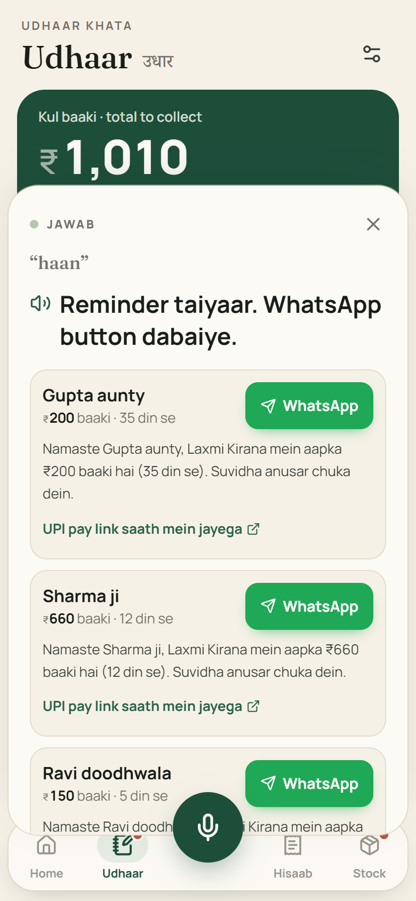
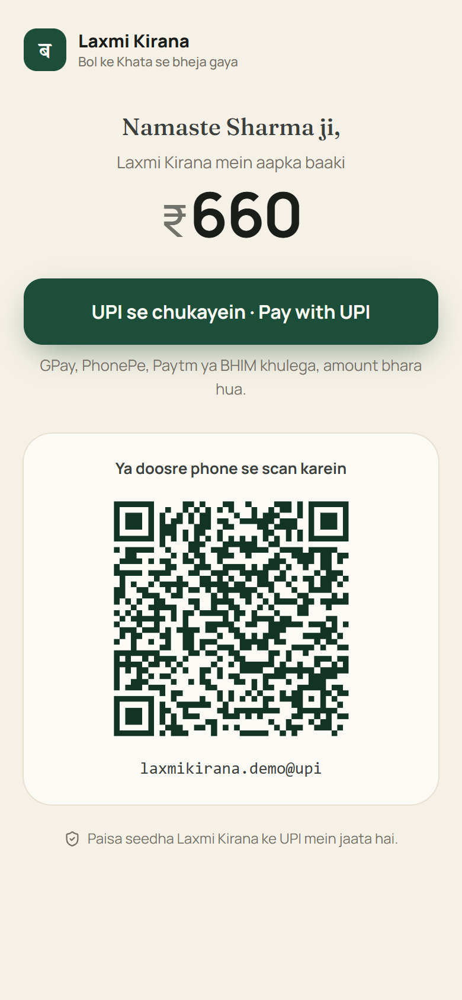
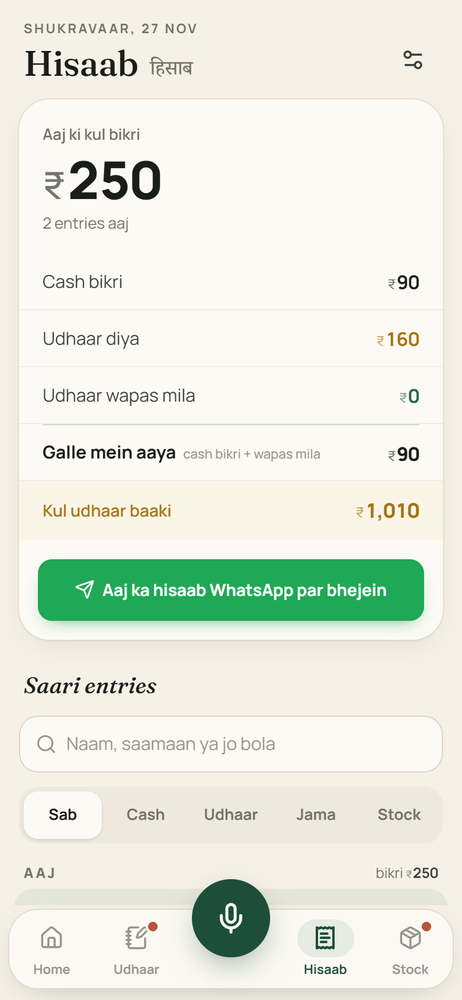
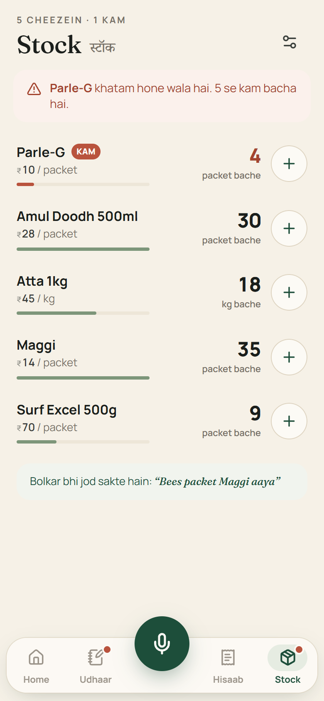
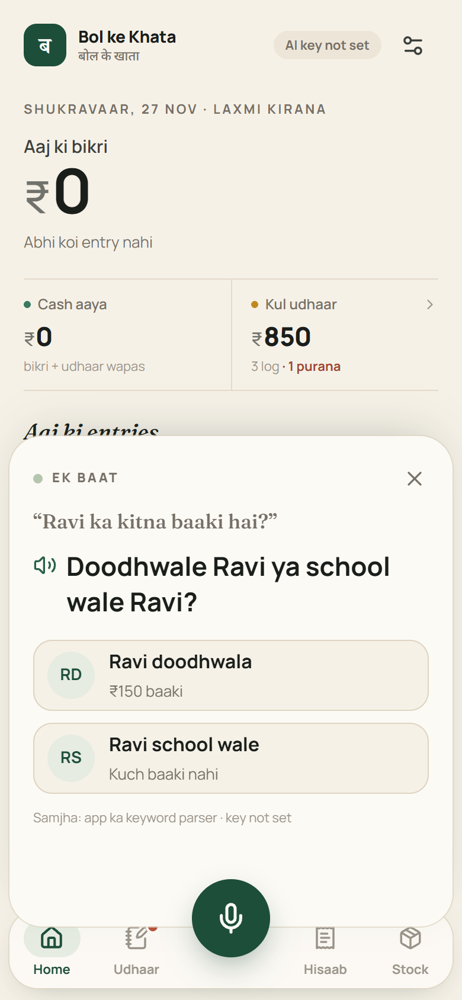

# Bol ke Khata (बोल के खाता)

A voice-first ledger for Indian kirana shops. The shopkeeper keeps the books by talking, in Hindi or Hinglish, while serving customers:

> "Sharma ji, do kilo atta, ek Surf, udhaar mein likh do."
> App: "Sharma ji, ₹160 udhaar. Sahi hai?" · "Haan." · "Likh diya. Ab ₹660 baaki."

It records sales, udhaar (credit), payments and stock; answers questions ("Aaj kitna bika?"); and helps get udhaar back: it shows how long each customer has owed, and sends WhatsApp reminders with a one-tap UPI pay link.

| Home: speak, see today | Confirm before writing udhaar | Saved, with the time it took |
|---|---|---|
|  |  |  |

| **Udhaar: who owes, how long** | **WhatsApp reminders** | **What the customer sees: UPI pay page** |
|---|---|---|
|  |  |  |

| **Hisaab: the day as a ledger page** | **Stock, low items first** | **Two customers named Ravi** |
|---|---|---|
|  |  |  |

## What stands out

- **Getting udhaar back, not just writing it down.** Each customer shows how long they have owed ("₹660 baaki · 12 din se"). Udhaar older than 30 days is marked red, and reminders go out longest-owed first. Each reminder carries a link to a pay page: the customer taps **Pay with UPI** and GPay / PhonePe / Paytm / BHIM opens with the amount filled in, or scans the QR from another phone. (WhatsApp doesn't make bare `upi://` links tappable, so the reminder links to this page instead.) Set your own UPI ID in the Customers tab; the demo uses a placeholder.
- **Seconds, measured.** Every spoken entry shows how long it took from the first word to the saved entry (🎙 3.3 s), including any "Sahi hai? · Haan". The Today tab shows the average.
- **The day's summary in one sentence.** "Aaj ka hisaab bhejo" reads the totals out and gets a WhatsApp summary ready: sales (cash / udhaar), money received, total udhaar outstanding, 30+ day dues, low stock.
- **Hands-free** for a busy counter, and **Claude only when needed** (see below).
- **Designed for the counter.** A warm, notebook-like look (ivory paper, forest-green ink, ruled ledger lines), one big mic always in the same place under the thumb, large money figures, and Hindi/Hinglish labels. Four places only: Home, Udhaar, Hisaab, Stock.

## Run it (one command)

```bash
docker compose up --build
```

Open **http://localhost:3000** in **Chrome** (speech recognition uses Chrome's built-in Web Speech API).

No API key or `.env` file is needed. Without a key the header shows **"AI key not set"** and the app uses its built-in Hinglish keyword parser, which handles the whole demo flow below.

### Install it as an app

Bol ke Khata is an installable web app (PWA): it gets its own icon, opens full-screen without the browser bar, and still opens without internet.

- **Laptop (Chrome / Edge):** open http://localhost:3000 and click the install icon at the right end of the address bar, or **Install** in the app's header.
- **Android (Chrome):** open the deployed HTTPS link, then tap **Install** in the app (or ⋮ → *Install app*).
- **iPhone (Safari):** open the HTTPS link, tap **Share** → *Add to Home Screen*.

Long-press the installed icon for shortcuts to Udhaar, Hisaab and Stock. Offline, the ledger keeps working (it is stored on the phone): type an entry or use the number pad; speech recognition and Claude need internet. Phones only allow installing and the microphone on **HTTPS** (or localhost), so use a deployed link on a phone.

### Deploy (HTTPS link)

The same Docker image runs anywhere that runs containers. On **Render** (free plan, HTTPS included): push this repository to GitHub, then in Render choose **New → Blueprint** and pick the repository; `render.yaml` sets everything up, including a `/healthz` health check. Add `ANTHROPIC_API_KEY` in Render's environment settings if you want Claude; without it the app shows "AI key not set" and works fully.

On a public link, `/api/parse` is limited to 20 requests a minute per visitor and 120 overall (`PARSE_PER_IP_PER_MIN`, `PARSE_ALL_PER_MIN`), so nobody can run up the Claude bill; over the limit the app quietly uses its keyword parser.

### Optional: Claude parsing

To have Claude (Haiku 5.5) understand freer sentences, copy `.env.example` to `.env` and set `ANTHROPIC_API_KEY`, then run `docker compose up --build` again.

The keyword parser still runs first, because it is instant and free. Claude is asked only when the keyword parser is unsure: a name or product matched only by sound, a word it doesn't know, or an item with no quantity. Clear sentences like the demo flow never wait on the network. If Claude errors or takes more than 4 seconds, the keyword result is used. The line under the caption shows which one understood each sentence.

### Hands-free mode

Tap **∞ Hands-free** beside the mic and just keep talking while serving customers: the mic reopens on its own after every reply, so no tap is needed between sales. Shop chatter that isn't a command ("kal match dekha kya?") is ignored silently instead of getting a "Samajh nahi aaya". Tap it again to turn it off.

### No microphone?

Tap **Likhein** on the home screen to type instead, tap the example sentence above the mic, or open **Settings → Bol ke dekhiye** for the whole demo flow in order and tap each sentence to send it as if it were spoken. The mic works on `localhost` or HTTPS; on other addresses Chrome blocks it and the app switches to typing.

## Try this flow (from the seed data)

| You say | App says |
|---|---|
| Sharma ji, do kilo atta, ek Surf, udhaar mein likh do. | Sharma ji, ₹160 udhaar. Sahi hai? |
| Haan | Likh diya. Ab ₹660 baaki. |
| Paanch Maggi aur do Parle-G, cash. | ₹90 cash, likh diya. Parle-G sirf 4 bache. *(saved without asking, Undo for 10 s, red LOW badge)* |
| Gupta aunty ne do sau diye. | Gupta aunty se ₹200 mile. Ab kuch baaki nahi. |
| Aaj kitna bika? | Aaj ₹250 ki bikri, ₹160 udhaar, ₹200 mile. |
| Ravi ka kitna baaki hai? | Doodhwale Ravi ya school wale Ravi? |
| Doodhwale | Ravi doodhwala ke ₹150 baaki. |
| Sabko payment reminder bhejo. | 2 logon ko reminder bhejun? |
| Haan | Reminder taiyaar. WhatsApp button dabaiye. *(longest-owed first, each with a UPI pay link)* |
| Bees packet Maggi aaya. | Maggi ab 55. |
| Aaj ka hisaab bhejo. | Aaj ₹250 ki bikri, ₹160 udhaar, ₹200 mile. Hisaab WhatsApp ke liye taiyaar. |
| Sharma ji ko reminder bhejo. | Sharma ji ko ₹660 ka reminder bhejun? *(just one customer)* |

Use **Settings → Demo data wapas laayein** to start again from the seed data.

### When things go wrong

- **Noise / chatter:** nothing is saved; "Samajh nahi aaya, thoda paas aakar boliye." After two misses, a number-pad card appears.
- **Missing details:** it asks only for the gap: "Cash ya udhaar?", "Kiske naam par?", "Atta kitne kilo?"
- **Accents:** names and products are matched by sound: "Sarma ji", "megi", "sarf" become Sharma ji, Maggi, Surf. Devanagari transcripts ("शर्मा जी दो किलो आटा") work too.
- **Mixed numbers:** "saade teen sau" = 350, "three fifty" = 350, "dedh" = 1.5, "dhai" = 2.5, "sava do" = 2.25.
- **Misheard amounts:** if the spoken total is more than 20% off the price list: "Price list se ₹160 banta hai. ₹160 likhun ya ₹340?" Sound-alike numbers (saat/saath, satrah/sattar) always get a read-back.
- **New names:** "Ramesh naya customer hai. Jodun?" · unknown product: "Colgate ka daam kya hai?"
- **Cancel / undo:** "ruko" or "cancel" drops the open card; "pichhli entry hatao" reverses the last entry.
- **Mic blocked:** a text box appears. **LLM down or slow:** the keyword parser takes over.

Long-press any entry to see exactly what was said.

## How it works

```
Mic (Web Speech API, hi-IN) ──> transcript ──> keyword parser (src/lib/parser.js, instant)
                                                 │ sure ──────────────────────────────┐
                                                 │ unsure                             │
                                                 ▼                                    │
                                   /api/parse (Claude Haiku 5.5, JSON only)           │
                                                 │ no key / error / > 4 s: keywords   │
                                                 ▼                                    ▼
                                   { intent, customer, items, mode, spoken_amount, confidence }
                                                 ▼
                       matching by sound (match.js) + all arithmetic (ledger.js)
                                                 ▼
                     conversation engine (dialog.js) ──> spoken reply (hi-IN voice) + caption
```

The AI model only extracts what was said. The app matches names to its own data and does all the money and stock maths, so totals are always exact.

| Path | What it does |
|---|---|
| `src/lib/dialog.js` | Conversation engine: confirmations, follow-up questions, error handling |
| `src/lib/parser.js` | Hinglish keyword parser and the step that matches parsed names to shop data |
| `src/lib/match.js` | Tokenising and sound-alike matching of names |
| `src/lib/numbers.js` | Spoken numbers in Hindi, Hinglish and English |
| `src/lib/translit.js` | Devanagari to Roman transliteration |
| `src/lib/ledger.js` | Balances, stock, totals, undo, udhaar age, reminder and UPI links, day summary |
| `src/components/PayPage.jsx` | The `/pay` page a customer opens from a reminder: UPI button and QR code |
| `src/lib/llm.js` | Keyword parser first, Claude only when unsure, with fallback |
| `src/lib/speech.js` | Speech recognition and spoken replies |
| `src/App.jsx` | App shell: the voice loop (listening, hands-free, follow-up questions, undo) and layout |
| `src/voice/` | The mic button, waveform and the conversation sheet (listening → understanding → asking → saved) |
| `src/screens/` | Home, Udhaar (with customer details), Hisaab, Stock, Settings |
| `src/ui/` | Design system: money, badges, sheets, number pad, bottom bar |
| `server/index.js` | Express server: serves the app, calls Claude (rate-limited), health check |
| `public/manifest.webmanifest`, `public/sw.js` | Installable app: name, icons, shortcuts; offline cache |
| `render.yaml` | One-click HTTPS deploy on Render |
| `test/acceptance.test.js` | The voice flow above, run as tests |

Data is stored in the browser (localStorage); there is no login.

## Development

```bash
npm install
npm test          # 19 acceptance tests, no key needed
npm run dev       # UI on http://localhost:5173, API on :3000
```

GitHub Actions (`.github/workflows/test.yml`) runs the tests, the build and a no-key `docker compose up` check on every push.
